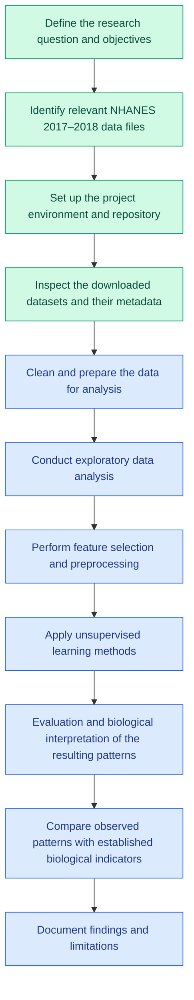

# Anaemia analysis using NHANES data

### Project overview
Anaemia is a condition characterised by reduced haemoglobin concentration. It often arises from multiple underlying causes, some of which are metabolically related, with multiple mechanisms often coexisting within the same individual. 
The presence of multiple underlying causes indicates that characterization  of contributing factors via isolated laboratory measurements can be challenging, particularly when individual measurements may not adequately discriminate between overlapping causes. In addition, the characteristic laboratory findings of one condition may mask or counterbalance those associated with another condition, predisposing to further examination to isolate the specific causal factors.

### Research Question
Can collective analysis of routinely collected clinical data, identify multidimensional biological patterns consistent with plausible aetiological mechanisms of multifactorial anaemia, and to what degree do these patterns overlap?

### Objective
The project aims to use unsupervised learning methods to assess the consistency of observable causes of multifactorial anaemia with characterised multidimensional patterns of multifactorial anaemia in NHANES participants.

### Data Source
The data were sourced from [NHANES 2017–2018 — National Center for Health Statistics](https://wwwn.cdc.gov/nchs/nhanes/continuousnhanes/default.aspx?BeginYear=2017)

#### Required Data Files

This project uses laboratory, demographic, and examination data from the NHANES 2017–2018 survey cycle. The following XPT files are currently included in the local data inventory.

| File           | Description                                   |
| -------------- | --------------------------------------------- |
| `DEMO_J.xpt`   | Demographic Variables and Sample Weights      |
| `CBC_J.xpt`    | Complete Blood Count with 5-Part Differential |
| `BIOPRO_J.xpt` | Standard Biochemistry Profile                 |
| `FERTIN_J.xpt` | Ferritin                                      |
| `FETIB_J.xpt`  | Iron Status                                   |
| `FOLATE_J.xpt` | Folate                                        |
| `HSCRP_J.xpt`  | High-Sensitivity C-Reactive Protein           |
| `TFR_J.xpt`    | Transferrin Receptor                          |

Download the required files from the NHANES 2017–2018 data files section and place them in the project's `data/` directory. The raw `.xpt` files are excluded from version control. They must be obtained separately before running the analysis.

### Project Status
In Progress

### Project Progress/ Workflow

